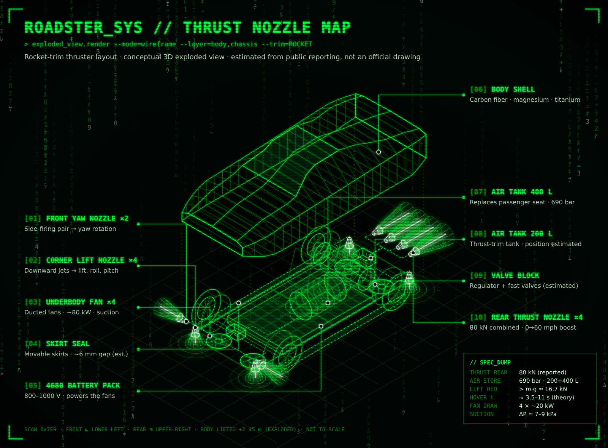
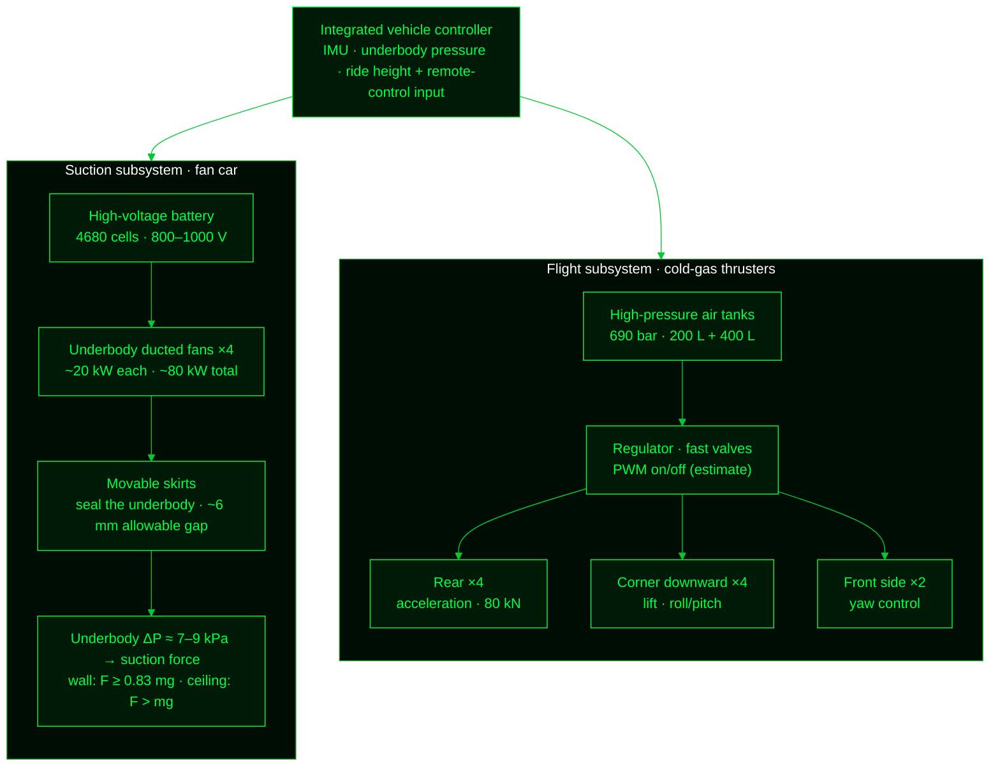
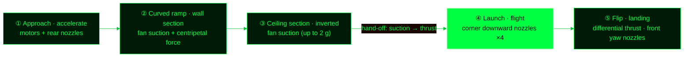

<div align="center">

# Tesla Roadster Flight & Suction Systems — A Reverse-Engineering Report




<sub>Rocket-trim thruster layout · conceptual 3D exploded view (body shell lifted to expose the underbody hardware) · vector source: <a href="assets/thrust-nozzle-map.svg">thrust-nozzle-map.svg</a></sub>

</div>

> [!IMPORTANT]
> **This is not an official drawing.** Tesla has not published engineering documents or drawings for these systems. This report starts from figures in press coverage, a patent and analysis of the demo footage, then works backwards with basic physics. It is a **conceptual reconstruction**.
> Every figure is tagged by origin: **[reported]** — stated by Tesla or in press coverage; **[estimate]** — calculated in this report.

## Contents

1. [Summary](#1-summary)
2. [System architecture](#2-system-architecture)
3. [How it sticks: the fan-car subsystem](#3-how-it-sticks-the-fan-car-subsystem)
4. [How it flies: cold-gas thrusters](#4-how-it-flies-cold-gas-thrusters)
5. [Demo sequence breakdown](#5-demo-sequence-breakdown)
6. [Control architecture](#6-control-architecture)
7. [Limits and unknowns](#7-limits-and-unknowns)
8. [Sources](#8-sources)

---

## 1. Summary

The force that holds the Roadster to a wall or ceiling comes from a **fan system that pulls the underbody toward a partial vacuum**. The force that lifts it off the ground comes from **cold-gas thrusters that blow high-pressure air through nozzles**. These are two unrelated physical principles, and the "flight" is a rocket-style hop lasting seconds, not sustained winged flight.

- **Suction**: four electric fans (about 80 kW in total) evacuate air from under the car, sealed in by skirts. The pressure difference against the atmosphere presses the car onto the surface. Tesla claims this can hold the car upside down even when it is stationary.
- **Flight**: air stored at 10,000 psi (about 690 bar) is released through 4 rear nozzles, 4 downward-facing corner nozzles and 2 front yaw nozzles. By this report's estimate, the downward thrust can exceed the car's weight (about 16.7 kN) for only a few seconds.
- **The demo (October 2026, near Waco, Texas)**: using fans and thrusters together, the car drove up a curved ramp until it was upside down, then launched off, flipped and landed.

## 2. System architecture

The "fly and stick" capability splits into a **suction subsystem (electric fans)** and a **flight subsystem (cold-gas thrusters)**, coordinated by one controller. They draw on different energy stores: the fans run on battery power, the thrusters on compressed air held in tanks.



The left side pulls air *out* to press the car down; the right side blows air *out* to push the car up. Two devices using air in opposite directions.

### Configurations by trim

| Trim | 0–60 mph | Top speed | Thrusters | Air tanks |
| --- | --- | --- | --- | --- |
| Performance | 1.6 s | 210 mph | None | None |
| Thrust | 0.85 s | 230 mph | 4 rear ports | 200 L |
| Rocket | 0.55 s (with 1-ft rollout) | 230+ mph | 4 rear + 4 corner downward + 2 front | 200 L + 400 L |

All figures in this table are [reported]. The Rocket trim is invite-only and not approved for public roads. Tesla has not said which trims get the fan suction system.

## 3. How it sticks: the fan-car subsystem

To hang upside down from a ceiling, the car needs the underbody pressure to sit only about **7–9 kPa below atmospheric (7–9% of an atmosphere)** [estimate]. Four fans totalling 80 kW can do that. The critical part is not fan power but **how well the skirts seal**.

```text
                 |          |          |       P_atm ~ 101 kPa (pushes down)
                 v          v          v
            +--------------------------------+
            |             CABIN              |
   +--------+--------------------------------+--------+
   |        ^ exhaust                  ^ exhaust      |   BODY
   |       [X] duct fan               [X] duct fan    |
+----+--+--------------------------------------+--+----+
|TIRE|##|  SEALED ZONE                         |##|TIRE|
|    |##|  P_u = P_atm - (7 ~ 9) kPa           |##|    |
|    |##|  F = dP x A  ==> car pulled down     |##|    |
|    +--+ -->  leak via ~6 mm gap   leak <--   +--+    |
+----+                                          +----+
========================================================  ROAD / CEILING
   ## = movable skirt      [X] = underbody duct fan (x4)
```

<sub>Front cross-section, concept only · not to scale · flip the whole picture for ceiling driving</sub>

### Operating sequence

1. Movable skirts on the sides, front and rear drop to turn the underbody into a sealed (or partly sealed) zone [reported, patent].
2. Four electric fans in underbody ducts pump air out of that zone [reported].
3. The underbody static pressure P<sub>u</sub> falls below atmospheric, and the pressure difference against the top of the car pushes it toward the surface.
4. At high speed, the front and rear skirts lift and the fans keep air moving to cut drag [reported].

Downforce from ordinary wings and diffusers grows with the square of speed and is zero at a standstill. The fans are electrically driven, so they make suction regardless of speed. **That is why the car can stick to a wall or ceiling even when it is not moving.**

### Core equation

```math
F_s = (P_{atm} - P_u)\,A_{eff}
```

- **Ceiling (upside down)**: F<sub>s</sub> > m·g. The force pressing the tires onto the surface is N = F<sub>s</sub> − m·g. With 2 g of suction, the car keeps 1 g of tire load while inverted — the same as driving on a flat road.
- **Wall (vertical)**: friction has to carry the car's weight, so μ·F<sub>s</sub> ≥ m·g. Assuming performance tires with μ ≈ 1.2, F<sub>s</sub> ≥ 0.83·m·g is enough [estimate].

### Design figures

| Item | Value | Origin |
| --- | --- | --- |
| Vehicle mass | under ~1,700 kg | [reported, Electrek estimate] |
| Vehicle weight m·g | 16.7 kN | [estimate] |
| Fans | 4 × ~20 kW = ~80 kW | [reported] |
| Downforce shown during demo | 4,700 kgf (~46 kN) | [reported, credibility questioned] |
| Suction per Musk | up to 2 g | [reported] |
| Effective sealed area A<sub>eff</sub> | ~5 m² | [estimate] |
| Required pressure drop (2 g case) | ~6.7 kPa | [estimate] |
| Required pressure drop (4,700 kgf case) | ~9.2 kPa | [estimate] |
| Allowable average skirt gap | ~6 mm | [estimate] |

### The skirt gap decides everything

The fans must pump out exactly as much air as leaks in under the skirts. Working backwards from fan power gives the allowable leak:

```math
Q = \frac{\eta\,P_{fan}}{\Delta P},\qquad Q = C_d\,A_{gap}\sqrt{\frac{2\,\Delta P}{\rho}}
```

With ΔP = 9.2 kPa, fan efficiency η = 0.6 and P = 80 kW, Q ≈ 5.2 m³/s and air rushes in through the gap at about 124 m/s [estimate]. The allowable gap area is about 0.07 m²; spread over an 11.6 m perimeter, that is an **average gap of 6 mm**. Any bump that breaks the seal collapses the suction, so the actuators that make the skirts track the surface in real time are the real heart of this system.

For comparison, the McMurtry Spéirling — about 1,000 kg with about 2,000 kgf of fan downforce — has already demonstrated driving upside down [reported]. Tesla applies the same principle to a heavier car.

## 4. How it flies: cold-gas thrusters

The Roadster is airborne only while the combined thrust of its four downward corner thrusters exceeds its 16.7 kN weight. Even burning every gram of stored air, theoretical hover time is **about 3.5–11 seconds** [estimate]. With no wings there is no aerodynamic lift, so in principle this is a rocket-style hop, closer to a Falcon 9 booster's landing attitude control than to an aircraft.

> [!NOTE]
> See the 3D exploded view at the top for nozzle positions. Rear nozzles [10] handle acceleration; corner downward nozzles [02] handle lift plus roll and pitch; front side nozzles [01] handle yaw. The lift nozzles must sit at the four corners so that thrust differences alone can create roll and pitch — the same logic as motor placement on a quadcopter.

| Location | Count | Jet direction | Function | Trim |
| --- | --- | --- | --- | --- |
| Rear | 4 ports | Backward | Acceleration (80 kN combined) [reported] | Thrust, Rocket |
| Four corners | 1 each | Downward | Lift, roll and pitch control | Rocket |
| Front sides | 2 | Left / right | Yaw rotation | Rocket |

### What cold-gas propulsion is

High-pressure inert gas (here, air) expands through a de Laval nozzle with no combustion, and the reaction produces thrust. It is the same family of hardware SpaceX uses for attitude control during Falcon 9 landings [reported]. It is simple and responds fast, but its specific impulse (I<sub>sp</sub>) is low, so it burns through propellant very quickly.

```math
F = \dot{m}\,I_{sp}\,g_0,\qquad I_{total} = m_{air}\,I_{sp}\,g_0
```

### Propellant storage

| Item | Value | Origin |
| --- | --- | --- |
| Storage pressure | 10,000 psi (~690 bar) | [reported] |
| Thrust-trim tank | 200 L | [reported] |
| Rocket-trim extra tank | +400 L (replaces the passenger seat) | [reported] |
| Air density at 690 bar | ~513 kg/m³ (compressibility Z ≈ 1.6) | [estimate] |
| Stored air mass | 200 L ≈ 100 kg; 600 L ≈ 310 kg | [estimate] |
| Effective I<sub>sp</sub> of cold air | ~60 s (typical range 50–70 s) | [estimate] |
| Refill time | 6–7 hours today; 30 minutes targeted | [reported] |

### Acceleration mode: rear thrusters

The four rear ports produce 80 kN combined [reported]. On a 1,700 kg car that adds about 4.8 g of acceleration on top of what the tires deliver [estimate]. The price is a mass flow of about 136 kg/s, which empties the 200 L tank (~100 kg) in **about 0.7 seconds** [estimate]. Since 0–60 mph takes under a second, the tank looks sized for exactly that window.

### Hover mode: corner downward thrusters

To lift off, the four downward nozzles together must exceed m·g (about 4.2 kN per nozzle if shared evenly). Mass flow is then about 28 kg/s, and theoretical hover time follows from the equation below (g<sub>0</sub> cancels out).

```math
t_{hover} \approx \frac{m_{air}\,I_{sp}}{m_{vehicle}}
```

- 200 L (~100 kg): ~3.5 s [estimate]
- 600 L (~310 kg): ~11 s [estimate]

Real-world numbers will be much shorter. Thrust falls as tank pressure falls (blow-down), air below the regulator's minimum pressure is unusable, and 690-bar composite tanks can weigh hundreds of kilograms themselves. That different cars were used for each demo is also read as a sign that full-power thrust lasts only a few seconds [reported].

## 5. Demo sequence breakdown

In the October 2026 demo, the Roadster used fans and thrusters together to drive up a curved ramp until upside down, then launched off, flipped and landed [reported]. Each phase is explained by one question: **which force is beating gravity right now?**



| Phase | Main force | Mechanics |
| --- | --- | --- |
| ① Approach & accelerate | Motors + rear nozzles, fans on | 80 kN of rear thrust briefly boosts ramp-entry speed. The fans are already pressing the tires down via underbody suction |
| ② Curved ramp (wall section) | Fan suction + centripetal force | No-slip condition μ·(F<sub>s</sub> + m·v²/r) ≥ m·g. Centripetal force adds to suction and increases the normal force |
| ③ Ceiling section (inverted) | Fan suction (up to 2 g) | Stays attached while N = F<sub>s</sub> + m·v²/r − m·g > 0. If suction exceeds gravity it hangs on even at zero speed (4,700 kgf shown on the demo display) |
| ④ Launch & flight | Corner downward nozzles ×4 | Releasing suction lets the car leave the ramp on a ballistic path (release method estimated). Downward nozzles correct altitude and attitude; air supply limits this to seconds |
| ⑤ Flip & landing | Differential thrust, front yaw nozzles | A left/right thrust difference creates roll torque (~360° in about 1 s, estimate). A downward burst just before touchdown slows the descent (estimate) |

### Force balance on the ramp

```math
N = F_s + \frac{m v^2}{r} - m g \cos\varphi
```

φ is 0° at the top of the ramp (fully inverted) and 180° at the bottom. For example, taking a 5 m radius at 10 m/s (36 km/h) gives a centripetal term of about 34 kN (about 2 g), enough on its own to hold the car through the ceiling section [estimate]. The fans are what keep the car attached when it slows or stops — which is what the "hanging upside down" moment in the demo shows.

### Kickflip (roll) estimate

```math
I_x \approx \frac{m\,(w^2 + h^2)}{12},\qquad \alpha = \frac{\tau}{I_x},\qquad t_{360} = 2\sqrt{\frac{\pi}{\alpha}}
```

Treating the body as a 1.9 m wide, 1.1 m tall box gives a roll moment of inertia of about 680 kg·m² [estimate]. If the two corner nozzles on one side each push 5 kN at a 0.9 m half-track, torque is about 9 kN·m and angular acceleration about 13 rad/s². Accelerating for half the rotation and braking for the other half, a full 360° takes **about 1 second** [estimate]. Thrust is only needed to start and stop the spin, so a flip uses far less air than hovering.

## 6. Control architecture

Both suction and flight are unstable states that only work with closed-loop control running at tens of milliseconds. Tesla says only that its all-electric actuators make micro-adjustments within a fraction of a second [reported]; the loop structure below is inferred from what the system must do [estimate].

| Control loop | Sensor inputs | Actuators | Goal |
| --- | --- | --- | --- |
| Suction loop | Underbody pressure, ride height, wheel loads | Fan speeds (×4), skirt height | Hold target ΔP, minimize leakage |
| Aero loop | Speed, load distribution | Active rear wing, 5 front flaps | Balance downforce and drag |
| Attitude loop (flight) | IMU attitude and rates, altitude | Corner valves (×4), front yaw nozzles (×2) | Stabilize roll, pitch, yaw; set landing attitude |
| Propulsion loop | Tank pressure, speed | Rear port valves (×4) | Acceleration profile, air budget |
| Steering | Steering input (remote) | Steer-by-wire | Steering by electrical signal with no mechanical link |

In flight, attitude control works like a quadcopter's differential thrust: a left/right difference makes roll, a front/rear difference makes pitch, and the front side nozzles handle yaw. Cold-gas valves are usually on/off devices, so thrust level was most likely modulated by PWM (the fraction of time each valve is open) [estimate].

The demo car was driven remotely with nobody inside [reported]. The flight sequence was therefore most likely a pre-programmed trajectory tracked by an automatic controller rather than flown by hand [estimate].

## 7. Limits and unknowns

The biggest uncertainty is that Tesla has never published hover time, thrust details or vehicle mass in an official document.

- **The 4,700 kgf downforce figure** was shown on the demo display; Electrek questioned whether it is exaggerated. It also disagrees with Musk's "up to 2 g" (about 3,400 kgf).
- **0–60 mph in 0.55 s** uses a 1-ft rollout (timing starts after the car has moved 30 cm), and frame analysis shows the thrusters firing before the car moved. The live demo recorded 0.81 s.
- **Hover time**: not published. A different car was used for each demo.
- **Whether production cars can fly**: unconfirmed. Thrusters exist only on the invite-only Rocket trim, which is not approved for public roads, and no certification path for public use has been published.
- **Suction on real roads**: untested in public how the system copes when potholes or manhole covers break the skirt seal.
- **Noise**: the thrusters are loud enough that spectators several hundred yards away wore earplugs.

### Assumptions behind this report's estimates

| Assumption | Value | Effect if it changes |
| --- | --- | --- |
| Effective sealed area | 5 m² | Smaller area → larger pressure drop and fan power needed |
| Fan efficiency | 0.6 | Lower efficiency → even tighter allowable gap |
| Air compressibility factor | 1.6 | Stored air mass shifts by about ±10% |
| Cold-gas I<sub>sp</sub> | 60 s | At 50 s, hover time drops by 17% |
| Vehicle mass | 1,700 kg | Rocket trim is likely heavier because of tank mass |

## 8. Sources

- [Electrek — an updated technical look at the next-gen Roadster (2026-10-15)](https://electrek.co/2026-10-15/an-updated-technical-look-at-teslas-kick-flipping-0-60-in-1s-next-gen-roadster/): 4 fans × 20 kW, 80 kN rear thrust, 10,000 psi tanks of 200/400 L, trim performance, McMurtry comparison
- [Teslarati — Roadster fan downforce system](https://www.teslarati.com/tesla-roadster-downforce-fan-system/): multi-mode fan and ground-sealing system, Thrust/Rocket thruster configurations, all-electric actuators
- [Teslarati — Waco demo coverage](https://www.teslarati.com/?p=303726): curved ramp → inverted → launch and flip → landing sequence
- [Drive Tesla Canada — fan suction system](https://driveteslacanada.ca/news/tesla-roadster-fan-suction-system-downforce/): Musk's "up to two g's" remark, 4,700 kg display figure
- [Tesla North — US Patent 12,746,987 B1](https://teslanorth.com/2026/09/29/roadster-electric-fan-car-patent/): electric fan-car patent (granted 2026-09-29)
- [InsideEVs — Tesla's fan-car patent](https://insideevs.com/news/768084/tesla-roadster-fan-car-patent/): speed-independent downforce, Chaparral 2J and Brabham BT46B lineage
- [Benzinga via Webull — demo preparation report](https://www.webull.ca/news-detail/15402037474960384): inert-gas propulsion, remotely operated with no driver
- [247 Wall St. — demo safety distance](https://247wallst.com/investing/2026/08/14/elon-musk-rumored-to-unveil-flying-car-soon-as-tesla-stock-is-down-24-ytd): spectator distance due to thruster noise
- [Tech Insider — regulatory analysis](https://tech-insider.org/tesla-roadster-spacex-package-regulatory-questions-2026/): no published specifications, no certification path
- [Futurism — fan suction patent](https://futurism.com/tesla-patents-sucking-device-roadster): real-world road surface concerns

---

## Repository layout

```text
.
├── README.md                      # this report
├── assets/
│   ├── thrust-nozzle-map.svg      # 3D thruster-layout exploded view (vector source)
│   └── thrust-nozzle-map.png      # PNG render of the same drawing
└── tools/
    └── gen_nozzle_map.py          # generator for the exploded view (Python 3, standard library only)
```

To regenerate the drawing:

```bash
python3 tools/gen_nozzle_map.py assets/thrust-nozzle-map.svg
```

<sub>This repository is an independent analysis based on public reporting and is not affiliated with Tesla, Inc. or SpaceX. Vehicle geometry and nozzle positions are conceptual and may differ from the real design.</sub>
